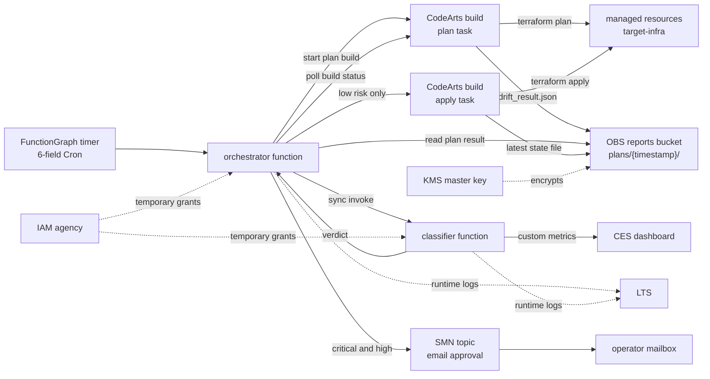

# Terraform Configuration Drift Detection and Remediation on Huawei Cloud

[](LICENSE)
[](https://www.huaweicloud.com)

A scheduled pipeline that continuously compares the live configuration of your cloud resources
with what your Terraform code declares, grades every difference by risk, auto-remediates only the
lowest risk band, and asks a human to approve everything else.

## Overview

Terraform only learns that a resource has changed when somebody runs `terraform plan`. In practice
security group rules, bucket policies, tags and grants keep being edited from the console or by
other tools, and the gap between code and reality eventually becomes too risky to close in one step.

This sample turns that check into an automated pipeline:

- **Scheduled comparison** — a FunctionGraph timer trigger starts a CodeArts build on a Cron
  schedule. Inside the build agent, `terraform plan -detailed-exitcode` runs against the managed
  resources and the structured plan result is written to OBS.
- **Risk grading** — a second function grades every resource change as `critical`, `high`, `low`
  or `none` and reports the outcome as CES custom metrics under a dedicated namespace, so the
  drift history stays visible on a monitoring dashboard.
- **Differentiated action** — only tag-only changes, which do not affect resource behaviour or
  connectivity, are handed to the remediation build. Everything that touches a security boundary,
  access control, a grant or encryption is announced through SMN email and waits for approval.
- **Full audit trail** — plan results, apply results and the state file are kept in one reports
  bucket under fixed object names; function logs are shipped to LTS.

**Problem it solves**: it automates the detect-grade-act-retain loop while keeping the
"act without asking" scope small enough to enumerate.

**Who it is for**: platform operations teams that maintain Terraform-managed Huawei Cloud estates,
and security or compliance teams that require change risk bands to be enforced before anything is
written back.

## Table of Contents

- [Architecture](#architecture)
- [Highlights](#highlights)
- [Cloud Services](#cloud-services)
- [Prerequisites](#prerequisites)
- [Quick Start](#quick-start)
- [Step-by-step Deployment](#step-by-step-deployment)
- [Usage and Verification](#usage-and-verification)
- [Repository Layout](#repository-layout)
- [Clean Up](#clean-up)
- [Further Reading](#further-reading)
- [FAQ](#faq)
- [License](#license)
- [Contact](#contact)

## Architecture



Two builds exist on the path: the plan build is read-only, and the apply build is started only when
the verdict is low risk. Neither function holds a long-lived key; the runtime grant is issued per
invocation through the IAM agency.

## Highlights

- **An enumerable auto-remediation scope.** Security groups and their rules, bucket policies and
  Block Public Access, grants and roles, and KMS keys are always graded `critical`. The resource
  bodies themselves and the pipeline's own components (buckets, functions, build tasks, log
  channels, topics) are graded `high`. Tag-only changes are graded `low`. Any resource type not
  listed falls back to `high` — the default is always the stricter band.
- **Packaging-time validation.** `scripts/package_functions.py` compiles every source file, checks
  that `index.py` sits at the archive root, and refuses built-in runtime modules and native
  extensions, so a broken bundle never reaches the function runtime.
- **No public downloads on the build agent.** The Terraform binary and the provider plugin mirror
  are pre-uploaded under the `tools/` prefix of the reports bucket; the build scripts fetch them
  over the internal OBS endpoint and generate a plugin mirror configuration on the fly.
- **Notifications that do not depend on alarm rules.** The functions publish directly to the SMN
  topic, which avoids the CES metric whitelist restriction for non-ECS namespaces.
- **State kept in the same bucket as the code.** The managed state lives at
  `state/target-infra.tfstate`; scans run serially, so only one build holds the state at a time and
  no external locking service is needed.
- **Observability is never on the control path.** A failed metric report only sets
  `metrics_reported=false` and logs a warning; it never invalidates a scan verdict.

## Cloud Services

| Cloud service | Role in this sample | Terraform resources |
|-|-|-|
| FunctionGraph | Hosts the orchestrator and classifier functions, the timer trigger, the asynchronous failure destination and the tracing configuration | `huaweicloud_fgs_function`, `huaweicloud_fgs_trigger`, `huaweicloud_fgs_async_invoke_configuration`, `huaweicloud_fgs_function_tracing_configuration` |
| CodeArts Build | Provides the project and the two build tasks that execute plans and applies | `huaweicloud_codearts_project`, `huaweicloud_codearts_build_task` |
| OBS | Stores plan results, apply results, the state file, function bundles and the offline toolchain | `huaweicloud_obs_bucket`, `huaweicloud_obs_bucket_object`, `huaweicloud_obs_bucket_bpa`, `huaweicloud_obs_bucket_policy` |
| KMS | Master key that encrypts the reports bucket and every object in it, with annual rotation enabled | `huaweicloud_kms_key` |
| SMN | Approval reminders for critical and high changes plus pipeline failure alerts, delivered over the email protocol | `huaweicloud_smn_topic`, `huaweicloud_smn_subscription` |
| CES | Receives the custom metrics reported by the classifier and renders the drift dashboard | `huaweicloud_ces_dashboard`, `huaweicloud_ces_dashboard_widget` |
| LTS | One log stream per function under a shared log group | `huaweicloud_lts_group`, `huaweicloud_lts_stream` |
| APM | Issues the access key used by function call tracing | `huaweicloud_apm_aksk` |
| IAM | The agency that lets functions call other services; the group, role and assignment in the managed resources | `huaweicloud_identity_agency`, `huaweicloud_identity_group`, `huaweicloud_identity_role`, `huaweicloud_identity_group_role_assignment` |
| VPC (security groups) | Security group and rules in the managed resources, used as a drift source | `huaweicloud_networking_secgroup`, `huaweicloud_networking_secgroup_rule` |

## Prerequisites

**Account and permissions**

- A Huawei Cloud account with the `cn-east-3` region available; this sample is verified there.
- The deploying identity needs enabled services and write access for FunctionGraph, CodeArts Build,
  OBS, KMS, SMN, CES, LTS and APM.
- Permission to create an agency: `huaweicloud_identity_agency.pipeline` grants roles to the
  `op_svc_cff` cloud service and has to separate global-level roles from project-level roles.
- Obtain your Access Key ID and Secret Access Key from the **My Credentials** page of the console
  and put them into the deployment script. Do not place credentials in code or commit them.

**Region and naming constraints**

- `var.region` defaults to `cn-east-3`; the project-level roles of the agency are attached there.
- `var.ces_metric_namespace` must follow the `service.item` shape: the first character of each
  segment is a letter, only letters, digits and underscores are allowed, total length is 3-32,
  the value does not start with `SYS`, `AGT` or `SRE`, and hyphens are not accepted.
- The reports bucket is named `<name_prefix>-reports-<account id>`, which must be globally unique;
  the default prefix is `tf-drift`.

**Toolchain**

- Terraform CLI `>= 1.5` (validated offline with 1.9.8).
- huaweicloud provider `~> 1.96.1`.
- Python 3.9 or later to run the packaging script and the local unit tests; the tests need only the
  standard library plus pytest.
- obsutil, used to upload the offline toolchain and packages to the reports bucket; the build
  scripts are written against `obsutil cp`.

**Values you must collect in advance**

| Value | Used by | Where to read it |
|-|-|-|
| Alert mailbox address | `var.notification_email` | Your own; after the subscription is created you must confirm it in the email |
| Build agent flavour | `var.build_machine_flavor` | The flavour list of the CodeArts Build console; it is a fixed value and must be given explicitly |
| Source type | `var.build_scm_type` | The source-type dropdown of the CodeArts Build console |
| Source URL | `var.build_scm_url` | The access URL of the source archive in OBS when using the packaged source |
| Build plug-in module id | `var.build_step_module_id` | The plug-in directory of the CodeArts Build console |
| Terraform archive and provider mirror | Fetched by the build agent | Prepare `terraform-<version>-linux-amd64.tar.gz` and the mirror tree yourself |

## Quick Start

Run the commands in order; the details are in the next section.

```bash
# 1. Build the code bundles (offline, no cloud call)
python scripts/package_functions.py

# 2. Local checks
python -m pytest src/functions -q
cd infra && TF_CLI_CONFIG_FILE=<offline plugin mirror config> terraform validate && cd ..

# 3. Manual step: upload the offline toolchain under the tools/ prefix of the reports bucket
#    tools/terraform-<TERRAFORM_VERSION>-linux-amd64.tar.gz
#    tools/provider-mirror/registry.terraform.io/huaweicloud/huaweicloud/<version>/linux_amd64/…
#    Use obsutil for this; configure its credentials first

# 4. Fill in deployment values and create the environment
cd infra
cp terraform.tfvars.example terraform.tfvars   # complete the required values listed above
export HW_ACCESS_KEY=<HW_ACCESS_KEY>
export HW_SECRET_KEY=<HW_SECRET_KEY>
terraform init
terraform plan -out=drift.tfplan
terraform apply drift.tfplan
```

## Step-by-step Deployment

### Step 1: build the code bundles

```bash
python scripts/package_functions.py
```

Expected output (`sha256` follows the source, entry counts are fixed):

```text
[OK] orchestrator src/functions/build/orchestrator.zip  条目 15  sha256 e330ab31b9b7  大小 36 KB
[OK] classifier   src/functions/build/classifier.zip  条目 15  sha256 455c25ec8a22  大小 34 KB
[OK] target-infra build/target-infra.zip  条目 3  sha256 66d19084ad07  大小 2 KB
```

The three paths match the defaults of `orchestrator_package`, `classifier_package` and
`target_infra_package` in `infra/variables.tf` character for character, so no extra argument is
needed. `bash src/functions/build.sh` is a thin wrapper over the same entry point, and
`python scripts/package_functions.py --only orchestrator classifier` builds a subset.
On failure a line starting with `[FAIL]` is printed and the exit code is 1.

### Step 2: run the local checks

```bash
python -m pytest src/functions -q
```

Expected output:

```text
131 passed in 0.24s
```

```bash
cd infra
terraform validate
```

Expected output:

```text
Success! The configuration is valid, but there were some
validation warnings as shown above.
```

When the official Huawei Cloud plugin mirror is not configured, the warning is the local
development-override notice and is expected. The managed resource folder can be checked separately:

```bash
cd ../target-infra && terraform init -backend=false && terraform validate && cd ../infra
```

### Step 3: upload the offline toolchain (manual prerequisite)

`buildscripts/plan.sh` and `buildscripts/apply.sh` fetch the toolchain from OBS only, so this tree
must already exist in the bucket, otherwise the first scan fails while preparing tools:

```text
obs://<reports bucket>/tools/terraform-<TERRAFORM_VERSION>-linux-amd64.tar.gz
obs://<reports bucket>/tools/provider-mirror/registry.terraform.io/huaweicloud/huaweicloud/<version>/linux_amd64/…
```

Command placeholders (read the bucket name with `terraform output reports_bucket`; the bucket does
not exist before Step 5, so either use a temporary bucket first or upload after the environment is
created):

```bash
obsutil cp ./terraform-1.9.8-linux-amd64.tar.gz obs://<reports bucket>/tools/terraform-1.9.8-linux-amd64.tar.gz
obsutil cp ./provider-mirror/ obs://<reports bucket>/tools/provider-mirror/ -r
```

`TERRAFORM_VERSION` is handed to the build by the environment and comes from
`var.terraform_version`, default `1.9.8`; it must match the uploaded file name. The archive is
extracted into `.tools/bin` of the build workspace.

### Step 4: fill in the deployment values

```bash
cp terraform.tfvars.example terraform.tfvars
```

`infra/terraform.tfvars.example` lists every value with comments. Only five are mandatory:
`notification_email`, `build_machine_flavor`, `build_scm_type`, `build_scm_url`,
`build_step_module_id`.

**Scan and observability**

| Variable | Type | Default | Required | Notes |
|-|-|-|-|-|
| `region` | string | `cn-east-3` | no | Huawei Cloud region; verified in cn-east-3 |
| `name_prefix` | string | `tf-drift` | no | Name prefix of every resource |
| `notification_email` | string | none | yes | Mailbox that receives drift alerts and approval reminders |
| `schedule_cron` | string | `0 0 */6 * * ?` | no | Six-field Cron expression (second minute hour day month weekday); day and weekday must not both be `*` |
| `trigger_enabled` | bool | `true` | no | Whether the scheduled scan trigger is created as active |
| `function_runtime` | string | `Python3.9` | no | Function runtime version |
| `orchestrator_memory_size` | number | `256` | no | Orchestrator memory in MB |
| `classifier_memory_size` | number | `256` | no | Classifier memory in MB |
| `classifier_timeout` | number | `60` | no | Classifier timeout in seconds; the orchestrator timeout is computed as `build_wait_seconds + 120` |
| `orchestrator_package` | string | `../src/functions/build/orchestrator.zip` | no | Path of the orchestrator bundle |
| `classifier_package` | string | `../src/functions/build/classifier.zip` | no | Path of the classifier bundle |
| `target_infra_package` | string | `../build/target-infra.zip` | no | Path of the managed-resource bundle |
| `log_retention_days` | number | `365` | no | Log stream retention in days |
| `report_retention_days` | number | `90` | no | Retention of plan result objects in days |
| `enable_tracing` | bool | `true` | no | Whether call tracing is configured for both functions |

**Custom metrics and dashboard**

| Variable | Type | Default | Required | Notes |
|-|-|-|-|-|
| `ces_metric_namespace` | string | `drift_detection.custom` | no | Custom metric namespace; must match both the reporter and the dashboard query |
| `metric_dimension_name` | string | `Pipeline` | no | Metric dimension name used by the function when reporting |
| `metric_dimension_value` | string | `drift-detection` | no | Metric dimension value used by the function when reporting |
| `enable_dashboard` | bool | `true` | no | Whether the drift dashboard is created |
| `dashboard_widget_view` | string | `line` | no | Widget chart style: `bar`, `line`, `bar_chart`, `table`, `circular_bar`, `area_chart` |
| `dashboard_metric_display_mode` | string | `multiple` | no | Metrics per widget: `single`, `multiple` |
| `dashboard_dimension_filter_type` | string | `specific_instances` | no | Dimension filter: `all_instances`, `specific_instances` |

**Build execution environment**

| Variable | Type | Default | Required | Notes |
|-|-|-|-|-|
| `codearts_project_type` | string | `common` | no | CodeArts project type |
| `build_scm_type` | string | none | yes | Source type, read from the CodeArts Build console dropdown |
| `build_scm_url` | string | none | yes | Source URL; the access URL of the source archive in OBS when using the bundled one |
| `build_step_module_id` | string | none | yes | Build plug-in module id, read from the console plug-in directory |
| `build_machine_arch` | string | `x86-64` | no | Build agent CPU architecture, `x86-64` or `arm`. The architecture segment of the offline tool archive is derived from it and handed to the build environment (`x86-64` uses `linux-amd64`, `arm64` uses `linux-arm64`), so the reports bucket must carry the matching Terraform archive |
| `build_machine_flavor` | string | none | yes | Build agent flavour, a fixed value that must be given explicitly |
| `terraform_version` | string | `1.9.8` | no | Terraform version used inside the build agent; must match the offline package |
| `plan_build_step_properties` | map(string) | `{}` | no | Plug-in properties of the plan step; for a shell-type plug-in usually `{ SCRIPT_PATH = "buildscripts/plan.sh" }` |
| `apply_build_step_properties` | map(string) | `{}` | no | Plug-in properties of the apply step, usually `{ SCRIPT_PATH = "buildscripts/apply.sh" }` |
| `build_wait_seconds` | number | `900` | no | Longest wait the orchestrator allows for one build to reach a terminal state |
| `build_poll_interval_seconds` | number | `15` | no | Interval at which the orchestrator polls build status |

**Agency grants and tags**

| Variable | Type | Default | Required | Notes |
|-|-|-|-|-|
| `agency_domain_roles` | list(string) | `["OBS Administrator", "KMS CMK Decrypter"]` | no | Global-level roles of the agency; names must match the IAM role list of the target account |
| `agency_project_roles` | list(string) | `["FunctionGraph FullAccess", "SMN FullAccess", "CES FullAccess", "CodeArts Build CommonOperator"]` | no | Project-level roles of the agency; names must match the IAM role list |
| `tags` | map(string) | `{ ManagedBy = "terraform", Pattern = "drift-detection" }` | no | Tags added to every resource |

Putting a role in the wrong scope still creates the agency, but the role is absent from the issued
grant and only the first call fails. Check the role type in the IAM list before substituting one.

### Step 5: create the scanning environment

```bash
cd infra
export HW_ACCESS_KEY=<HW_ACCESS_KEY>
export HW_SECRET_KEY=<HW_SECRET_KEY>
terraform init
terraform plan -out=drift.tfplan
terraform apply drift.tfplan
```

With both optional switches on, the plan is expected to report:

```text
Plan: 28 to add, 0 to change, 0 to destroy.
```

That is 2 functions, 1 timer trigger, 1 asynchronous invocation configuration, 1 APM access key and
2 tracing configurations, 1 CodeArts project and 2 build tasks, 1 reports bucket with 3 objects,
1 Block Public Access configuration and 2 bucket policies, 1 KMS key, 1 topic and 1 subscription,
1 log group with 2 log streams, 1 agency, and 1 dashboard with 3 widgets. The 4 dashboard
resources depend on `enable_dashboard`; the 3 tracing-related resources depend on `enable_tracing`.

```text
Apply complete! Resources: 28 added, 0 changed, 0 destroyed.
```

With both switches off the count is 21.

### Step 6: read the deployment outputs

```bash
terraform output
```

Expected output names (identical to `infra/outputs.tf`):

```text
agency_name
alert_topic_urn
apply_build_job_id
classifier_function_urn
dashboard_id
encryption_key_id
log_group_name
managed_state_object_key
orchestrator_function_urn
plan_build_job_id
plan_object_prefix
reports_bucket
scan_cron
source_object_key
```

A single value: `terraform output <name>`, for example `terraform output reports_bucket` to feed
the toolchain upload of Step 3.

### Step 7: seed the managed-resource state

The state of `target-infra/` is kept at `state/target-infra.tfstate` in the reports bucket
(the object name is `terraform output managed_state_object_key`). On a fresh deployment no state
object exists, so the first scan treats every resource as to-be-created. Seed it once:

Option A — run the apply build task, whose `PIPELINE_MODE` parameter is `apply`.
`buildscripts/apply.sh` writes the state back to `STATE_KEY` after `terraform apply`.

Option B — upload it yourself:

```bash
obsutil cp ./terraform.tfstate obs://<reports bucket>/state/target-infra.tfstate
```

The managed resources declare their own variables, separate from the scanning environment:

| Variable | Type | Default | Required | Notes |
|-|-|-|-|-|
| `region` | string | `cn-east-3` | no | Huawei Cloud region |
| `name_prefix` | string | `tf-drift-target` | no | Resource name prefix |
| `assets_bucket` | string | none | yes | Globally unique bucket name for application static assets |
| `assets_kms_key_id` | string | none | yes | Master key that encrypts the assets bucket; take it from `terraform output encryption_key_id` |
| `allowed_cidr` | string | `192.168.0.0/16` | no | Internal CIDR allowed to reach port 443 |
| `tags` | map(string) | `{ ManagedBy = "terraform" }` | no | Tags added to the resources |

## Usage and Verification

### Offline checks (before any deployment)

```bash
python scripts/package_functions.py      # three [OK] lines, exit code 0
python -m pytest src/functions -q        # 131 passed
cd infra && terraform validate           # Success! The configuration is valid
```

None of these three commands contacts a cloud endpoint.

### Smallest scenario: introduce one drift and read the verdict

1. Change a tag on the managed assets bucket from the console — that is a low-risk change.
2. Wait for the next scan window, or start the plan build task once.
3. Read the result object:

```bash
obsutil ls obs://<reports bucket>/plans/ -s
obsutil cat obs://<reports bucket>/plans/<timestamp>/drift_result.json
```

`<timestamp>` looks like `20260101T000000Z`; the `plans` prefix comes from
`terraform output plan_object_prefix`.

### Trigger one scan by hand

In the FunctionGraph console, run a test invocation of `tf-drift-orchestrator` with this event:

```json
{
  "dry_run": true,
  "wait_seconds": 60,
  "poll_interval": 5
}
```

`dry_run` completes the plan build and the grading, then skips the remediation build and the
notification. Other optional event fields: `plan_key` selects a specific result object,
`classification` injects a verdict for rehearsal, `plan_job_id` / `apply_job_id` point at other
build tasks.

The first log line is always:

```text
=== HANDLER ENTRY: orchestrator ===
```

Progress lines follow per stage, and the last line carries the verdict:

```text
[INFO] request_id=<request id> 巡检结束 status=remediated severity=low message=共 1 项差异：严重 0、高 0、低 1
```

`status` is one of the branches of `_act()`: `no_drift`, `remediated`, `pending_approval`,
`would_remediate` and `would_notify` (dry run), or `failed` together with `failed_stage`.
Each log line carries a timestamp field in front of the level bracket, omitted above. Polling
stops on any terminal build status such as `success`, `failed` or `timeout`; only `success`,
`successed` and `successful` count as a successful build.

### Verify the classifier on its own

Test-invoke `tf-drift-classifier` with (disabling the metric report keeps this a local rehearsal):

```json
{
  "plan_key": "plans/<timestamp>/drift_result.json",
  "report_metrics": false
}
```

The response contains `severity`, `action`, `message`, `counts`, `critical_changes`,
`high_changes`, `low_changes`, plus `plan_format`, `drift_detected`, `parsed_change_count`,
`actionable_change_count` and `diagnostics`. `action` takes one of three values: `none`,
`auto_remediate` (low risk only) and `notify_and_approve` (critical and high).

When nothing drifted, `message` reads `未发现需要处理的配置差异`
("no differences that need action"). The folder `src/functions/tests/fixtures/` holds six sample
results — `plan_with_drift.json`, `critical_only.json`, `low_risk_only.json`, `no_drift.json`,
`state_drift_only.json` and `plan_stream.jsonl` — covering structured plans, critical-only,
low-risk-only, no drift, state-only drift and the line-oriented event stream.

### Verify the notification path

1. Get the topic URN with `terraform output alert_topic_urn`.
2. Make sure the mailbox has confirmed the SMN subscription.
3. Introduce a critical change (for example delete the ingress 443 rule of the managed security
   group) and trigger a scan. Expect an email whose subject is
   `Terraform Drift Approval Required` and whose first two body lines are:

```text
巡检发现需要人工确认的配置差异。
风险等级：critical
```

The body lists the counts, the change details, the result object location and how to approve the
fix; the command text comes from the `APPROVE_COMMAND` value handed out at deployment, by default
`terraform apply -auto-approve`. Pipeline failures arrive as `Terraform Drift Pipeline Failed` with
the failing stage and build numbers.

### Verify the dashboard

Open the dashboard named `tf-drift-dashboard` in the CES console. The three widgets query
`DriftDetected` and `NoDrift`; `Drift_Critical`, `Drift_High`, `Drift_Low`; and
`DriftResourceCount`. Namespace and dimension come from `ces_metric_namespace`,
`metric_dimension_name` and `metric_dimension_value` as deployed. If no data shows up, verify those
three values against what the function reports first.

### Verify the audit trail and logs

- Bucket: `plans/` holds every scan result, `state/target-infra.tfstate` is the latest state, and
  `applies/<timestamp>/apply_result.json` is the apply summary.
- Listing: `obsutil ls obs://<reports bucket>/ -r | head`.
- LTS: the group named by `terraform output log_group_name` contains one stream per function.

**After deploying, run through this section in a live environment and confirm the behaviour before
treating the delivery as complete.**

## Repository Layout

```text
.
├── README.md
├── README.en.md
├── LICENSE
├── docs/
│   ├── architecture.md          Components, data flow, design decisions
│   └── deployment-guide.md      Step-by-step commands with expected output
├── infra/                       Terraform configuration of the scanning environment
│   ├── providers.tf             Terraform and provider version constraints
│   ├── variables.tf             Input variables
│   ├── locals.tf                Fixed object names and function runtime settings
│   ├── obs.tf                   Reports bucket, code objects, public access block, policies
│   ├── kms_smn.tf               Master key, alert topic, email subscription
│   ├── functions.tf             Functions, timer trigger, async destination, tracing
│   ├── codearts.tf              Project plus the plan and apply build tasks
│   ├── monitoring.tf            Dashboard and widget metric queries
│   ├── logs.tf                  Log group and the two log streams
│   ├── iam.tf                   Agency used by the functions
│   ├── outputs.tf               Published outputs
│   └── terraform.tfvars.example Sample input values
├── target-infra/                The resources that are scanned
│   ├── main.tf                  Bucket, bucket policy, security group, grants
│   ├── variables.tf
│   └── outputs.tf
├── src/
│   └── functions/               Function sources and local unit tests
│       ├── orchestrator/        Orchestrator entry point
│       ├── classifier/          Classifier entry point
│       ├── common/              Capability layer shared by both functions
│       ├── tests/               Tests and plan-result fixtures
│       ├── build/               Function bundles (generated, not committed)
│       └── build.sh             Thin wrapper around the packaging script
├── scripts/
│   └── package_functions.py     Bundle builder with pre-pack validation
├── build/                       Managed-resource bundle directory (generated, not committed)
└── buildscripts/
    ├── plan.sh                  Scan script executed on the build agent
    └── apply.sh                 Remediation script executed on the build agent
```

## Clean Up

Once the sample is no longer needed, release the resources so that nothing is left behind:

```bash
cd infra
terraform destroy
```

Expected output:

```text
Destroy complete! Resources: 28 destroyed.
```

The reports bucket is declared with `force_destroy = true` and versioning enabled, so historical
object versions — including the toolchain under `tools/` — are removed together with the bucket;
re-uploading the toolchain is required to rebuild the environment.

To pause the scheduled scan while keeping the environment and its history: the trigger's status and
timer fields are released to runtime control in the configuration, so changing `trigger_enabled`
produces no difference. Disable the trigger in the FunctionGraph console instead, where the status
takes `ACTIVE` or `DISABLED`. Changing the schedule is a forced replacement: destroy the trigger and
recreate it.

## Further Reading

- Components, end-to-end data flow and design decisions: [docs/architecture.md](docs/architecture.md)
- Full command walkthrough with expected output: [docs/deployment-guide.md](docs/deployment-guide.md)
- Chinese edition: [README.md](README.md)

## FAQ

**The function reports that the entry point cannot be found.**
`index.py` must be at the archive root and the handler is `index.main_handler`. The packaging script
enforces this, so a bundle produced by `python scripts/package_functions.py` is always correct.

**The plan build fails while preparing the toolchain.**
The `tools/` prefix is missing an archive that matches `TERRAFORM_VERSION`, or the object hierarchy
differs from the paths given in Step 3.

**A function call is rejected for insufficient permissions.**
Roles were placed in the wrong agency scope: global roles belong to `agency_domain_roles`, project
roles to `agency_project_roles`. OBS data plane authorisation is evaluated from bucket policies
only, so the reports bucket policy must also allow the agency; both are declared in
`infra/iam.tf` and `infra/obs.tf`.

**The dashboard is empty.**
The metric namespace, metric name or dimension does not match what the function reports. A
namespace containing a hyphen, or starting with `SYS`, `AGT` or `SRE`, is rejected on write.

**No alert email arrives.**
An SMN email subscription delivers nothing until you confirm it in the email that is sent after the
subscription is created.

**Every `terraform plan` shows a change in the build step.**
The plug-in version is filled in by the service and the configuration already ignores
`steps[0].version`; if a difference still appears, something other than the version changed — check
`module_id` and the step properties.

**The new scan schedule did not take effect.**
Trigger schedule fields force replacement and a live timer trigger cannot be rewritten in place;
destroy the trigger and recreate it.

## License

This practice is published under the MIT No Attribution license; see [LICENSE](LICENSE).

## Contact

Created and maintained by: Public Cloud Continuous Operations Department.
