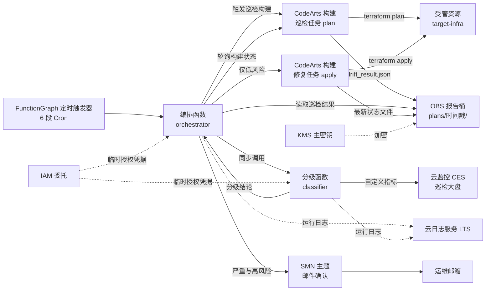

# 基于 FunctionGraph 与 CodeArts 构建的 Terraform 配置漂移巡检实践

[](LICENSE)
[](https://www.huaweicloud.com)

用定时任务周期性地把「云上真实配置」与「代码声明的期望配置」做比对，对每一处差异判定风险等级，
只在低风险场景自动收敛，其余场景发通知等待人工确认。适用于已用 Terraform 管理云资源、
但资源仍会被控制台或其他工具改动的团队。

## 简介

Terraform 只能在有人执行 `terraform plan` 时才知道配置是否被改动。生产环境里，安全组、桶策略、
标签、权限授予经常被控制台临时修改，时间一长，代码与真实环境的差异会积累到无法安全收敛的程度。

本实践把这件事变成一条自动运行的链路：

- **定时比对**：函数工作流 FunctionGraph 的定时触发器按 Cron 周期发起一次巡检构建，构建机内执行
  `terraform plan -detailed-exitcode`，把结构化巡检结果写入对象存储服务 OBS。
- **风险分级**：独立的分级函数按资源类型与变更范围给出 `critical` / `high` / `low` / `none` 结论，
  并把结果上报到云监控服务 CES 的自定义命名空间，在巡检大盘上长期可视化。
- **分级处置**：只有「只改标签」这类不影响资源行为与连通性的差异才允许自动执行修复构建；
  涉及安全边界、访问控制、权限授予与加密配置的差异一律只发通知，由消息通知服务 SMN 邮件提醒运维确认。
- **全程留痕**：巡检结果、修复结果与状态文件按固定对象名存放在同一个报告桶；函数运行日志进入云日志服务 LTS。

**解决的问题**：配置漂移的「发现—判级—处置—留痕」全链路自动化，同时把「自动动手」的范围严格限制在
不会造成服务中断的变更上。

**适用于**：需要长期维护 Terraform 代码与真实环境一致性的平台运维团队；对「自动修复」持谨慎态度、
要求变更按风险分档处理的合规或安全团队。

## 目录

- [架构图](#架构图)
- [方案亮点](#方案亮点)
- [涉及云服务](#涉及云服务)
- [前置条件](#前置条件)
- [快速开始](#快速开始)
- [分步部署](#分步部署)
- [使用方法与验证](#使用方法与验证)
- [仓库结构](#仓库结构)
- [清理资源](#清理资源)
- [详细说明](#详细说明)
- [常见问题](#常见问题)
- [许可证](#许可证)
- [联系方式](#联系方式)

## 架构图



链路上有两次构建执行：巡检构建只读（`terraform plan`），修复构建只在分级结论为低风险时触发。
两个函数都不持有长期密钥，运行期授权由 IAM 委托按调用签发。

## 方案亮点

- **变更按风险分档，自动动手的范围可枚举**：安全组与规则、桶策略与公开访问阻断、权限授予、
  主密钥这类资源固定判为严重；资源本体与巡检链路自身（桶、函数、构建任务、日志通道、消息主题）判为高风险；
  仅标签变化判为低风险。未收录的资源类型默认按高风险处理，从严不放宽。
- **代码包构建期就做校验**：`scripts/package_functions.py` 在打包前逐个编译源码、校验入口位置与包内层级，
  并拦截运行时内置模块与原生扩展混入，避免上传后才发现「找不到入口」。
- **构建机不访问公网**：Terraform 可执行文件与 provider 插件镜像预先放在报告桶的 `tools/` 前缀，
  构建脚本只从内网对象存储取包并生成插件镜像配置。
- **不依赖服务侧告警规则**：通知链路由函数直接发布到 SMN 主题，绕开云监控对非云服务器命名空间的指标白名单限制。
- **状态与代码同库存放**：受管资源的状态文件按固定对象名 `state/target-infra.tfstate` 存放在报告桶，
  巡检串行执行，同一时刻只有一个构建任务持有状态，无需额外的状态加锁服务。
- **观测与执行解耦**：指标上报失败只在返回值里标记 `metrics_reported=false` 并记日志，不会让巡检结论作废。

## 涉及云服务

| 云服务 | 本实践中的职责 | 对应 Terraform 资源 |
|-|-|-|
| 函数工作流 FunctionGraph | 承载编排函数与分级函数、定时巡检触发器、异步调用失败投递、调用链追踪配置 | `huaweicloud_fgs_function`、`huaweicloud_fgs_trigger`、`huaweicloud_fgs_async_invoke_configuration`、`huaweicloud_fgs_function_tracing_configuration` |
| CodeArts 构建 | 提供两个构建任务作为巡检与修复的执行环境 | `huaweicloud_codearts_project`、`huaweicloud_codearts_build_task` |
| 对象存储服务 OBS | 存放巡检结果、修复结果、状态文件、函数代码包与离线工具链 | `huaweicloud_obs_bucket`、`huaweicloud_obs_bucket_object`、`huaweicloud_obs_bucket_bpa`、`huaweicloud_obs_bucket_policy` |
| 密钥管理服务 KMS | 报告桶与代码包对象的加密主密钥，开启周期性轮换 | `huaweicloud_kms_key` |
| 消息通知服务 SMN | 严重与高风险变更的人工确认提醒、链路故障提醒，邮件协议订阅 | `huaweicloud_smn_topic`、`huaweicloud_smn_subscription` |
| 云监控服务 CES | 接收分级函数上报的自定义指标并展示巡检大盘 | `huaweicloud_ces_dashboard`、`huaweicloud_ces_dashboard_widget` |
| 云日志服务 LTS | 两个函数各自的运行日志流 | `huaweicloud_lts_group`、`huaweicloud_lts_stream` |
| 应用性能管理服务 APM | 为函数调用链追踪签发接入密钥 | `huaweicloud_apm_aksk` |
| 统一身份认证服务 IAM | 函数访问云服务使用的委托与角色授权；受管资源里的用户组与自定义权限 | `huaweicloud_identity_agency`、`huaweicloud_identity_group`、`huaweicloud_identity_role`、`huaweicloud_identity_group_role_assignment` |
| 虚拟私有云 VPC（安全组） | 受管资源中的安全组与规则，作为漂移来源示例 | `huaweicloud_networking_secgroup`、`huaweicloud_networking_secgroup_rule` |

## 前置条件

**账号与权限**

- 已开通华为云账号并完成实名认证，可用区域为 `cn-east-3`（本实践在该区域验证）。
- 执行部署的账号具备以下服务的开通与操作权限：函数工作流、CodeArts 构建、对象存储、密钥管理、
  消息通知、云监控、云日志、应用性能管理。
- 具备创建委托的权限：委托 `huaweicloud_identity_agency.pipeline` 需要把角色授予给云服务
  `op_svc_cff`，并同时区分全局级角色与项目级角色两个层级。
- 在「我的凭证」页面获取 Access Key ID 与 Secret Access Key，填入部署脚本；
  不要把凭据写入代码或提交到仓库。

**区域与命名约束**

- `var.region` 默认为 `cn-east-3`；委托的项目级角色按该区域项目挂载。
- 自定义指标命名空间 `var.ces_metric_namespace` 必须为 `service.item` 形式：段首为字母，
  仅含字母、数字与下划线，总长 3-32，不以 `SYS`、`AGT`、`SRE` 开头，且不允许使用连字符。
- 报告桶名为 `<name_prefix>-reports-<主账号 ID>`，全局唯一，默认前缀 `tf-drift`。

**工具版本**

- Terraform CLI `>= 1.5`（本实践离线验证使用 1.9.8）。
- huaweicloud Provider `~> 1.96.1`。
- Python 3.9 及以上，用于运行代码包构建脚本与本地测试；测试用例只依赖标准库与 pytest。
- obsutil 命令行工具，用于把离线工具链与代码包上传到报告桶（构建脚本按 `obsutil cp` 编写）。

**需要你提前准备的信息**

| 信息 | 用途 | 获取位置 |
|-|-|-|
| 接收告警的邮箱地址 | `var.notification_email` | 自建；主题订阅创建后需在邮件中点击确认，否则收不到通知 |
| 构建机规格 | `var.build_machine_flavor` | CodeArts 构建控制台的新建任务规格下拉列表，属固定规格，必须显式填写 |
| 代码源类型 | `var.build_scm_type` | CodeArts 构建控制台的代码源类型下拉列表 |
| 源码地址 | `var.build_scm_url` | 使用内置代码包时填 OBS 中源码归档的访问地址 |
| 构建插件模块 ID | `var.build_step_module_id` | CodeArts 构建控制台所选插件的模块 ID |
| Terraform 离线安装包与插件镜像 | 构建机内取包 | 自行准备 `terraform-<版本>-linux-amd64.tar.gz` 与 provider 镜像目录并上传 |

## 快速开始

以下命令按顺序执行即可完成一次部署，详细说明见下一节。

```bash
# 1. 构建代码包（离线，不访问任何云端接口）
python scripts/package_functions.py

# 2. 本地校验
python -m pytest src/functions -q
cd infra && TF_CLI_CONFIG_FILE=<离线插件镜像配置> terraform validate && cd ..

# 3. 手工前置：把离线工具链上传到报告桶的 tools/ 前缀
#    tools/terraform-<TERRAFORM_VERSION>-linux-amd64.tar.gz
#    tools/provider-mirror/registry.terraform.io/huaweicloud/huaweicloud/<版本>/linux_amd64/…
#    命令由 obsutil 提供，需先配置好 obsutil 的访问凭据

# 4. 填写部署参数并创建资源
cd infra
cp terraform.tfvars.example terraform.tfvars   # 按前置条件表填写必填项
export HW_ACCESS_KEY=<HW_ACCESS_KEY>
export HW_SECRET_KEY=<HW_SECRET_KEY>
terraform init
terraform plan -out=drift.tfplan
terraform apply drift.tfplan
```

## 分步部署

### 第 1 步：构建代码包

```bash
python scripts/package_functions.py
```

预期输出（`sha256` 随源码变化，条目数固定）：

```text
[OK] orchestrator src/functions/build/orchestrator.zip  条目 15  sha256 e330ab31b9b7  大小 36 KB
[OK] classifier   src/functions/build/classifier.zip  条目 15  sha256 455c25ec8a22  大小 34 KB
[OK] target-infra build/target-infra.zip  条目 3  sha256 66d19084ad07  大小 2 KB
```

产物路径与 `infra/variables.tf` 中 `orchestrator_package`、`classifier_package`、
`target_infra_package` 的默认取值逐字一致，因此不需要额外传参。
也可以用薄封装入口 `bash src/functions/build.sh`，或只构建其中一个：
`python scripts/package_functions.py --only orchestrator classifier`。

失败时会打印 `[FAIL] <产物名>: <原因>` 并以退出码 1 结束。

### 第 2 步：本地静态校验

```bash
python -m pytest src/functions -q
```

预期输出：

```text
131 passed in 0.24s
```

```bash
cd infra
terraform validate
```

预期输出：

```text
Success! The configuration is valid, but there were some
validation warnings as shown above.
```

未使用华为云官方插件镜像时，警告内容是本地开发覆盖的提示，属预期输出。

受管资源目录同样可以单独校验：

```bash
cd ../target-infra && terraform init -backend=false && terraform validate && cd ../infra
```

### 第 3 步：上传离线工具链（手工前置动作）

构建脚本 `buildscripts/plan.sh` 与 `buildscripts/apply.sh` 只从内网对象存储取包，
桶内必须先存在以下层级，否则首次巡检构建会在准备工具链阶段失败：

```text
obs://<报告桶名>/tools/terraform-<TERRAFORM_VERSION>-linux-amd64.tar.gz
obs://<报告桶名>/tools/provider-mirror/registry.terraform.io/huaweicloud/huaweicloud/<版本>/linux_amd64/…
```

上传命令占位（`<报告桶名>` 在部署完成后可从 `terraform output reports_bucket` 取得；
桶在第 5 步才创建，可先建一个临时桶上传，或先完成第 5 步建桶再补传工具链）：

```bash
obsutil cp ./terraform-1.9.8-linux-amd64.tar.gz obs://<报告桶名>/tools/terraform-1.9.8-linux-amd64.tar.gz
obsutil cp ./provider-mirror/ obs://<报告桶名>/tools/provider-mirror/ -r
```

`TERRAFORM_VERSION` 由构建任务下发，取值来自 `var.terraform_version`，默认 `1.9.8`，
必须与上传的文件名一致；文件包内的可执行文件会被解压到构建工作区的 `.tools/bin`。

### 第 4 步：填写部署参数

```bash
cp terraform.tfvars.example terraform.tfvars
```

`infra/terraform.tfvars.example` 已给出全部可填项与注释。必填项只有 5 个：
`notification_email`、`build_machine_flavor`、`build_scm_type`、`build_scm_url`、`build_step_module_id`。

**巡检与观测参数**

| 变量 | 类型 | 默认值 | 必填 | 说明 |
|-|-|-|-|-|
| `region` | string | `cn-east-3` | 否 | 华为云区域，本实践在 cn-east-3 验证 |
| `name_prefix` | string | `tf-drift` | 否 | 所有资源的名称前缀 |
| `notification_email` | string | 无 | 是 | 接收漂移告警与审批提醒的邮箱地址 |
| `schedule_cron` | string | `0 0 */6 * * ?` | 否 | 漂移巡检的 6 段 Cron 表达式（秒 分 时 日 月 周），「周」与「日」不能同时为 `*` |
| `trigger_enabled` | bool | `true` | 否 | 是否启用定时巡检触发器 |
| `function_runtime` | string | `Python3.9` | 否 | 函数运行时版本 |
| `orchestrator_memory_size` | number | `256` | 否 | 编排函数内存，单位 MB |
| `classifier_memory_size` | number | `256` | 否 | 分类函数内存，单位 MB |
| `classifier_timeout` | number | `60` | 否 | 分类函数执行超时，单位秒；编排函数超时由 `build_wait_seconds + 120` 计算 |
| `orchestrator_package` | string | `../src/functions/build/orchestrator.zip` | 否 | 编排函数代码包路径 |
| `classifier_package` | string | `../src/functions/build/classifier.zip` | 否 | 分类函数代码包路径 |
| `target_infra_package` | string | `../build/target-infra.zip` | 否 | 受管资源代码包路径 |
| `log_retention_days` | number | `365` | 否 | 日志流保留天数 |
| `report_retention_days` | number | `90` | 否 | 巡检报告对象的保留天数 |
| `enable_tracing` | bool | `true` | 否 | 是否为函数开启调用链追踪 |

**自定义指标与巡检大盘**

| 变量 | 类型 | 默认值 | 必填 | 说明 |
|-|-|-|-|-|
| `ces_metric_namespace` | string | `drift_detection.custom` | 否 | 自定义指标命名空间，须与函数上报及大盘取数一致 |
| `metric_dimension_name` | string | `Pipeline` | 否 | 自定义指标维度名称，须与函数上报使用的维度名一致 |
| `metric_dimension_value` | string | `drift-detection` | 否 | 自定义指标维度取值，须与函数上报使用的维度值一致 |
| `enable_dashboard` | bool | `true` | 否 | 是否创建漂移巡检监控大盘 |
| `dashboard_widget_view` | string | `line` | 否 | 组件图表样式，取值 `bar`、`line`、`bar_chart`、`table`、`circular_bar`、`area_chart` |
| `dashboard_metric_display_mode` | string | `multiple` | 否 | 单个组件展示的指标数量，取值 `single`、`multiple` |
| `dashboard_dimension_filter_type` | string | `specific_instances` | 否 | 组件维度筛选方式，取值 `all_instances`、`specific_instances` |

**构建执行环境**

| 变量 | 类型 | 默认值 | 必填 | 说明 |
|-|-|-|-|-|
| `codearts_project_type` | string | `common` | 否 | CodeArts 项目类型 |
| `build_scm_type` | string | 无 | 是 | 构建任务的代码源类型，取值见 CodeArts 构建控制台的代码源下拉列表 |
| `build_scm_url` | string | 无 | 是 | 构建任务源码地址；使用内置代码包时填 OBS 中源码归档的访问地址 |
| `build_step_module_id` | string | 无 | 是 | 构建步骤的插件模块 ID，取值见 CodeArts 构建控制台的插件目录 |
| `build_machine_arch` | string | `x86-64` | 否 | 构建机 CPU 架构，取值 `x86-64` 或 `arm`。离线工具包的架构段由它推导并下发给构建环境（`x86-64` 取 `linux-amd64`、`arm64` 取 `linux-arm64`），报告桶 `tools/` 前缀下必须有对应架构的 Terraform 安装包 |
| `build_machine_flavor` | string | 无 | 是 | 构建机规格，属固定规格，必须显式填写 |
| `terraform_version` | string | `1.9.8` | 否 | 构建环境内使用的 Terraform 版本，需与离线工具包一致 |
| `plan_build_step_properties` | map(string) | `{}` | 否 | 巡检构建步骤的插件参数；使用 Shell 脚本类插件时通常为 `{ SCRIPT_PATH = "buildscripts/plan.sh" }` |
| `apply_build_step_properties` | map(string) | `{}` | 否 | 修复构建步骤的插件参数，通常为 `{ SCRIPT_PATH = "buildscripts/apply.sh" }` |
| `build_wait_seconds` | number | `900` | 否 | 编排函数等待单次构建完成的最长秒数 |
| `build_poll_interval_seconds` | number | `15` | 否 | 编排函数轮询构建状态的间隔秒数 |

**委托授权与标签**

| 变量 | 类型 | 默认值 | 必填 | 说明 |
|-|-|-|-|-|
| `agency_domain_roles` | list(string) | `["OBS Administrator", "KMS CMK Decrypter"]` | 否 | 委托绑定的全局级角色，须与目标账号 IAM 权限列表中的角色名称一致 |
| `agency_project_roles` | list(string) | `["FunctionGraph FullAccess", "SMN FullAccess", "CES FullAccess", "CodeArts Build CommonOperator"]` | 否 | 委托绑定的项目级角色，须与目标账号 IAM 权限列表中的角色名称一致 |
| `tags` | map(string) | `{ ManagedBy = "terraform", Pattern = "drift-detection" }` | 否 | 为所有资源追加的标签 |

全局级与项目级角色授错层级时，委托创建成功但角色不进临时授权，调用才报权限不足，
因此换用其它角色前先在 IAM 权限列表核对角色类型。

### 第 5 步：创建巡检环境

```bash
cd infra
export HW_ACCESS_KEY=<HW_ACCESS_KEY>
export HW_SECRET_KEY=<HW_SECRET_KEY>
terraform init
terraform plan -out=drift.tfplan
terraform apply drift.tfplan
```

`terraform plan` 预期会创建以下资源（按 `infra/*.tf` 声明逐条核对）：

```text
Plan: 28 to add, 0 to change, 0 to destroy.
```

其中包含 2 个函数、1 个定时触发器、1 个异步调用配置、1 个 APM 接入密钥与 2 个调用链配置、
1 个 CodeArts 项目与 2 个构建任务、1 个报告桶、3 个桶对象、1 个公开访问阻断、2 条桶策略、
1 个主密钥、1 个主题与 1 个订阅、1 个日志组与 2 个日志流、1 个委托、
1 个大盘与 3 个大盘组件。大盘的 4 个资源受 `enable_dashboard` 控制，
APM 密钥与 2 个调用链配置共 3 个资源受 `enable_tracing` 控制。

`terraform apply` 完成后预期输出：

```text
Apply complete! Resources: 28 added, 0 changed, 0 destroyed.
```

两个开关全部关闭时为 21 个资源。

### 第 6 步：查看部署输出

```bash
terraform output
```

预期看到以下输出名（与 `infra/outputs.tf` 逐字一致）：

```text
agency_name
alert_topic_urn
apply_build_job_id
classifier_function_urn
dashboard_id
encryption_key_id
log_group_name
managed_state_object_key
orchestrator_function_urn
plan_build_job_id
plan_object_prefix
reports_bucket
scan_cron
source_object_key
```

单个值用 `terraform output <输出名>` 获取，例如取报告桶名以便第 3 步补传工具链：

```bash
terraform output reports_bucket
```

### 第 7 步：准备受管资源的初始状态

受管资源 `target-infra/` 的状态文件放在报告桶的 `state/target-infra.tfstate`
（对象名来自 `terraform output managed_state_object_key`）。首次部署时桶内没有状态文件，
巡检会按「全部资源待创建」处理，因此建议先落一次状态：

方式一，触发一次修复构建（构建任务参数 `PIPELINE_MODE = apply`），
`buildscripts/apply.sh` 执行完 `terraform apply` 后会把状态写回 `STATE_KEY`。

方式二，手工上传：

```bash
obsutil cp ./terraform.tfstate obs://<报告桶名>/state/target-infra.tfstate
```

受管资源自身使用的变量如下，与巡检环境的变量分属两个 Terraform 配置目录：

| 变量 | 类型 | 默认值 | 必填 | 说明 |
|-|-|-|-|-|
| `region` | string | `cn-east-3` | 否 | 华为云区域 |
| `name_prefix` | string | `tf-drift-target` | 否 | 资源名称前缀 |
| `assets_bucket` | string | 无 | 是 | 应用静态资源的桶名，须全局唯一 |
| `assets_kms_key_id` | string | 无 | 是 | 加密应用静态资源的主密钥 ID，由巡检环境创建后传入，可取 `terraform output encryption_key_id` |
| `allowed_cidr` | string | `192.168.0.0/16` | 否 | 允许访问 443 的内网网段 |
| `tags` | map(string) | `{ ManagedBy = "terraform" }` | 否 | 为资源追加的标签 |

## 使用方法与验证

### 离线验证（部署前可做）

```bash
python scripts/package_functions.py      # 期望 3 行 [OK]，退出码 0
python -m pytest src/functions -q        # 期望 131 passed
cd infra && terraform validate           # 期望 Success! The configuration is valid
```

这三条命令不访问任何云端接口，可作为交付前自检。

### 最简示例：制造一次漂移并观察结论

1. 在云监控或对象存储控制台把受管资源桶的标签改掉（属于低风险变更）。
2. 等待下一个巡检周期，或手动触发一次巡检构建任务。
3. 查看巡检结果对象：

```bash
obsutil ls obs://<报告桶名>/plans/ -s
obsutil cat obs://<报告桶名>/plans/<时间戳>/drift_result.json
```

`<时间戳>` 形如 `20260101T000000Z`，前缀 `plans` 来自 `terraform output plan_object_prefix`。

### 手动触发一次巡检

在函数工作流控制台对编排函数 `tf-drift-orchestrator` 执行「测试函数」，事件填入：

```json
{
  "dry_run": true,
  "wait_seconds": 60,
  "poll_interval": 5
}
```

`dry_run` 为演练模式：完成巡检构建与分级，但跳过修复构建与通知发送。
其余可选事件字段：`plan_key` 直接指定巡检结果对象、`classification` 直接给定分级结论、
`plan_job_id` / `apply_job_id` 临时改用其它构建任务。

函数日志首行固定为：

```text
=== HANDLER ENTRY: orchestrator ===
```

随后按阶段打印进度，结尾一行给出本次结论：

```text
[INFO] request_id=<请求编号> 巡检结束 status=remediated severity=low message=共 1 项差异：严重 0、高 0、低 1
```

日志每行前面还有一个时间戳字段，上例省略。构建状态轮询到 `success`、`failed`、`timeout` 等终态取值
即结束等待，判定成功的取值为 `success`、`successed`、`successful`。

`status` 取值来自 `_act()` 的分支：`no_drift`（无差异）、`remediated`（已自动修复）、
`pending_approval`（已发通知等待确认）、`would_remediate` / `would_notify`（演练模式跳过动作）、
`failed`（链路异常，同时带 `failed_stage`）。

### 单独验证分级函数

对函数 `tf-drift-classifier` 填入事件（`report_metrics` 关闭时不写指标，适合本地演练）：

```json
{
  "plan_key": "plans/<时间戳>/drift_result.json",
  "report_metrics": false
}
```

返回结构包含 `severity`、`action`、`message`、`counts`、`critical_changes`、
`high_changes`、`low_changes`，以及 `plan_format`、`drift_detected`、`parsed_change_count`、
`actionable_change_count`、`diagnostics`。`action` 取值只有三种：
`none`、`auto_remediate`（仅低风险）、`notify_and_approve`（严重与高风险）。

无差异时 `message` 为：

```text
未发现需要处理的配置差异
```

也可以用样例夹具本地演练：`src/functions/tests/fixtures/` 下有
`plan_with_drift.json`、`critical_only.json`、`low_risk_only.json`、`no_drift.json`、
`state_drift_only.json`、`plan_stream.jsonl` 六种巡检结果样本，
分别覆盖结构化计划、纯严重、纯低风险、无差异、仅状态差异与逐行事件流六种输入形态。

### 验证通知链路

1. 在 `infra` 目录执行 `terraform output alert_topic_urn` 取主题 URN。
2. 确认邮箱已在 SMN 控制台完成订阅确认。
3. 制造一次严重变更（例如删除受管资源安全组的 443 入方向规则）并触发巡检，
   预期收到主题为 `Terraform Drift Approval Required` 的邮件，正文首两行为：

```text
巡检发现需要人工确认的配置差异。
风险等级：critical
```

邮件里会列出差异条数、变更明细、巡检结果对象位置，以及确认修复的方式
（命令文本来自部署时下发的 `APPROVE_COMMAND`，默认为 `terraform apply -auto-approve`）。
链路故障时收到的邮件主题为 `Terraform Drift Pipeline Failed`，正文会带上失败阶段与构建编号。

### 验证巡检大盘

云监控控制台打开名为 `tf-drift-dashboard` 的大盘，三个组件分别取数：
「巡检结论」看 `DriftDetected` 与 `NoDrift`，「变更风险分级」看 `Drift_Critical`、
`Drift_High`、`Drift_Low`，「漂移资源数」看 `DriftResourceCount`；
命名空间与维度取 `ces_metric_namespace`、`metric_dimension_name`、`metric_dimension_value` 的部署值。
大盘无数据时优先核对这三个值是否与函数上报取值完全一致。

### 验证留痕与日志

- 报告桶：`plans/` 前缀存放每次巡检结果，`state/target-infra.tfstate` 为最新状态，
  `applies/<时间戳>/apply_result.json` 为修复执行摘要。
- 桶内对象清单：`obsutil ls obs://<报告桶名>/ -r | head`。
- LTS 日志：日志组 `terraform output log_group_name`，其下两个日志流分别对应两个函数。

**部署完成后请按本节步骤在真实环境自行验证，确认功能可用后方可视为交付完成。**

## 仓库结构

```text
.
├── README.md
├── README.en.md
├── LICENSE
├── docs/
│   ├── architecture.md          架构组成、数据流与关键设计取舍
│   └── deployment-guide.md      分步部署命令与每步预期输出
├── infra/                       巡检环境的 Terraform 配置
│   ├── providers.tf             Terraform 与 Provider 版本约束
│   ├── variables.tf             输入变量
│   ├── locals.tf                桶内固定对象名与函数运行期配置
│   ├── obs.tf                   报告桶、代码包对象、公开访问阻断与桶策略
│   ├── kms_smn.tf               加密主密钥、告警主题与邮件订阅
│   ├── functions.tf             两个函数、定时触发器、异步投递与调用链追踪
│   ├── codearts.tf              CodeArts 项目与巡检、修复两个构建任务
│   ├── monitoring.tf            巡检大盘与组件取数配置
│   ├── logs.tf                  LTS 日志组与两个日志流
│   ├── iam.tf                   函数访问云服务使用的委托
│   ├── outputs.tf               对外输出
│   └── terraform.tfvars.example 输入示例
├── target-infra/                被巡检的目标资源定义
│   ├── main.tf                  桶、桶策略、安全组与权限示例资源
│   ├── variables.tf
│   └── outputs.tf
├── src/
│   └── functions/               函数源码与本地测试用例
│       ├── orchestrator/        编排函数入口
│       ├── classifier/          分级函数入口
│       ├── common/              两个函数共用的能力层
│       ├── tests/               测试用例与巡检结果样例夹具
│       ├── build/               函数代码包产物目录（构建生成，不入库）
│       └── build.sh             构建入口的薄封装
├── scripts/
│   └── package_functions.py     代码包构建与打包前校验
├── build/                       受管资源代码包产物目录（构建生成，不入库）
└── buildscripts/
    ├── plan.sh                  构建机内执行巡检的脚本
    └── apply.sh                 构建机内执行修复的脚本
```

## 清理资源

确认不再需要本实践后，释放资源以避免残留：

```bash
cd infra
terraform destroy
```

预期输出：

```text
Destroy complete! Resources: 28 destroyed.
```

报告桶已声明 `force_destroy = true` 且开启了版本控制，销毁时会连带清理历史版本对象；
桶内 `tools/` 前缀上传的离线工具链也会随之删除，重建环境时需要重新上传。

如果只想停掉定时巡检、保留环境与历史报告：定时触发器的启用状态与周期字段在配置中已让出所有权，
`trigger_enabled` 的改动不会产生差异，需要在函数工作流控制台把该触发器停用
（状态取值 `ACTIVE` / `DISABLED`）。调整巡检周期属于强制新建项，需先销毁该触发器再重建。

## 详细说明

- 架构组成、端到端数据流与关键设计取舍：[docs/architecture.md](docs/architecture.md)
- 从零到可验证部署的完整命令与预期输出：[docs/deployment-guide.md](docs/deployment-guide.md)
- 英文版说明：[README.en.md](README.en.md)

## 常见问题

**函数报「找不到入口」。**
代码包根目录必须有 `index.py`，处理器写 `index.main_handler`。构建脚本会校验这一点，
只要用 `python scripts/package_functions.py` 生成的包即可。

**巡检构建在准备工具链阶段失败。**
`tools/` 前缀缺少与 `TERRAFORM_VERSION` 同名的安装包或 provider 镜像目录，
或对象名层级与第 3 步给出的路径不一致。

**函数调用返回权限不足。**
委托的角色授错层级：全局级角色放 `agency_domain_roles`，项目级角色放 `agency_project_roles`，
换角色前先核对 IAM 权限列表中的角色类型。对象存储数据面只认桶策略，不认委托角色，
报告桶读写还需要桶策略放行，这两条已由 `infra/iam.tf` 与 `infra/obs.tf` 声明。

**大盘没有数据。**
自定义指标命名空间、指标名或维度名与函数上报取值不一致；
命名空间含连字符或以 `SYS`、`AGT`、`SRE` 开头时指标写入会被拒绝。

**收不到告警邮件。**
SMN 邮件订阅创建后需要在邮件中点击确认；未确认的订阅不会投递消息。

**每次 `terraform plan` 都提示构建步骤有变更。**
构建插件版本号由服务侧回填，配置里已对 `steps[0].version` 让出所有权；
若仍出现差异，说明改动的不只是版本号，请核对 `module_id` 与步骤参数。

**调整巡检周期后没有生效。**
定时触发器的周期字段为强制新建项且生效中不支持原地改写，需先销毁该触发器再重建。

## 许可证

本实践采用 MIT No Attribution 许可证发布，详见 [LICENSE](LICENSE)。

## 联系方式

创建与维护团队：公有云持续运营部。
