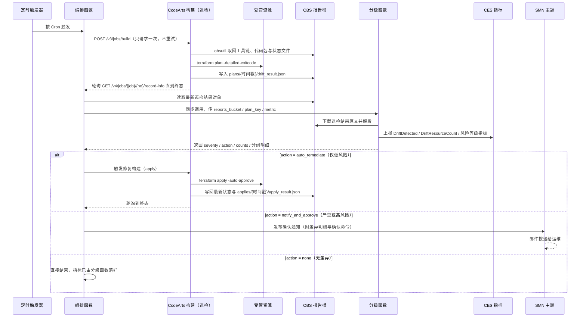
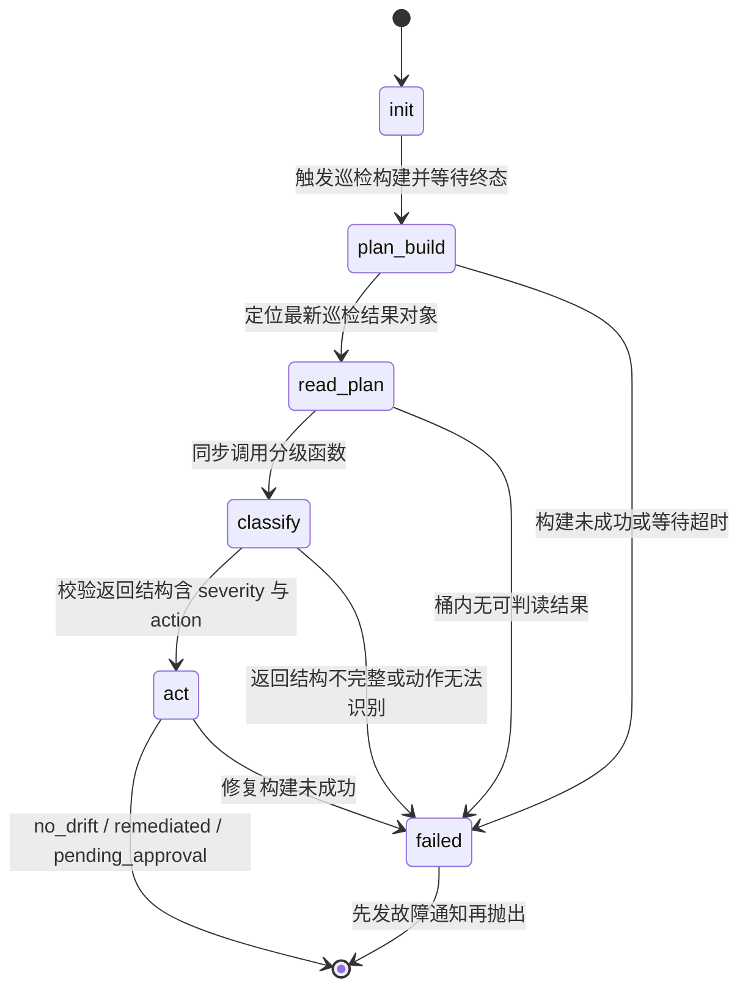
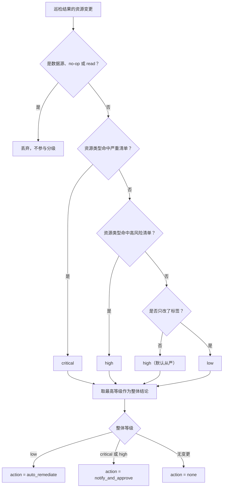

# 架构与技术设计

本文按华为云视角说明本实践的架构组成、端到端数据流与关键设计取舍。
部署命令见 [deployment-guide.md](deployment-guide.md)，功能概览见仓库根目录 `README.md`。

## 1. 分层与职责

整条链路分成五层，每层只依赖下一层的固定契约。

| 层 | 职责 | 落地位置 |
|-|-|-|
| 声明层 | 描述「期望配置」，是比对的唯一基准 | `target-infra/`（被巡检资源）、`infra/`（巡检环境自身） |
| 执行层 | 真正运行 `terraform plan` 与 `terraform apply` | CodeArts 构建的两个构建任务 + `buildscripts/plan.sh`、`buildscripts/apply.sh` |
| 调度与编排层 | 按周期发起构建、等待终态、取回结果、决定动作 | FunctionGraph 编排函数 `orchestrator` |
| 判定层 | 逐条变更判风险等级、上报观测数据 | FunctionGraph 分级函数 `classifier` |
| 存储与观测层 | 巡检结果、状态文件、代码包、离线工具链、日志与指标 | OBS 报告桶、LTS 日志流、CES 自定义指标与大盘 |

授权与加密横切各层：IAM 委托为函数签发按调用生效的临时授权，KMS 主密钥加密桶内所有对象。

## 2. 组件清单

### 2.1 函数（`infra/functions.tf`）

| 组件 | 配置要点 |
|-|-|
| `orchestrator` 函数 | 运行时取 `var.function_runtime`（默认 `Python3.9`），处理器 `index.main_handler`，内存 `var.orchestrator_memory_size`，超时由 `var.build_wait_seconds + 120` 计算，代码包以 `code_type = "obs"` 挂载 |
| `classifier` 函数 | 处理器同为 `index.main_handler`，内存 `var.classifier_memory_size`，超时 `var.classifier_timeout` |
| 定时触发器 `scheduled_scan` | 类型 `TIMER`，`status` 由 `var.trigger_enabled` 决定，取值 `ACTIVE` / `DISABLED`；周期取 `var.schedule_cron`，`schedule_type = "Cron"` |
| 异步调用配置 `classifier_failure` | 最多重试 2 次、事件最长存活 3600 秒、开启异步状态日志；`on_failure.destination = "SMN"`，`param` 为告警主题 URN 的 JSON 串 |
| 调用链追踪 | 先由 `huaweicloud_apm_aksk` 签发接入密钥，再为两个函数各挂一份追踪配置；整体受 `var.enable_tracing` 控制 |

两个函数都声明 `replace_triggered_by` 指向各自的代码包对象：代码包重新上传后函数需要重建，
否则仍在运行旧包。

### 2.2 执行环境（`infra/codearts.tf`）

- 1 个 CodeArts 项目 `tf-drift-pipeline`，类型取 `var.codearts_project_type`。
- 2 个构建任务：`tf-drift-plan`（步骤名 `detect-drift`）与 `tf-drift-apply`（步骤名 `remediate-drift`）。
  两者共用架构 `var.build_machine_arch`、规格 `var.build_machine_flavor` 与代码源配置，
  通过任务参数 `PIPELINE_MODE`（`plan` / `apply`）区分用途。
- 步骤参数由 `local.build_common_params` 与用户侧 `var.plan_build_step_properties` /
  `var.apply_build_step_properties` 合并而来。下发给构建机的键为：
  `REPORTS_BUCKET`、`OBS_ENDPOINT`、`STATE_KEY`、`SOURCE_KEY`、`TERRAFORM_VERSION`、`HW_REGION`。
- 构建任务对 `steps[0].version` 让出所有权：插件版本号由服务侧回填，不让权会导致每次巡检计划都出现假差异。

### 2.3 存储（`infra/obs.tf`）

| 对象 | 键名来源 | 内容 |
|-|:-:|-|
| `plans/<时间戳>/drift_result.json` | `local.plan_object_prefix` = `plans` | 巡检结果，构建脚本按 UTC 时间戳建目录 |
| `plans/<时间戳>/plan.tfplan` | 同上 | 计划二进制，供同一次链路的修复构建复用 |
| `applies/<时间戳>/apply_result.json` | `buildscripts/apply.sh` 内固定 | 修复执行摘要 |
| `state/target-infra.tfstate` | `local.state_object_key` | 受管资源的状态文件 |
| `source/target-infra.zip` | `local.source_object_key` | 受管资源代码包 |
| `functions/orchestrator.zip`、`functions/classifier.zip` | `local.orchestrator_zip_key`、`local.classifier_zip_key` | 两个函数的代码包 |
| `tools/terraform-<版本>-linux-amd64.tar.gz`、`tools/provider-mirror/…` | 使用者手工上传 | 构建机的离线工具链 |

桶自身：`acl = "private"`、开启版本控制与默认加密（`sse_algorithm = "kms"`），
两条生命周期规则按 `var.report_retention_days` 过期历史报告与非当前版本；
`huaweicloud_obs_bucket_bpa` 四项全开禁止匿名访问；
两条桶策略分别强制 HTTPS 与放行委托读写。

### 2.4 加密、通知与观测

- `huaweicloud_kms_key.pipeline`：报告桶与所有对象的加密主密钥，`pending_days = 7`、
  开启周期性轮换、轮换间隔 365 天。
- `huaweicloud_smn_topic.drift_alerts` + 邮件订阅：人工确认与链路故障的通知出口。
- `huaweicloud_lts_group.pipeline` + 两个日志流：函数运行日志，保留期取 `var.log_retention_days`。
- `huaweicloud_ces_dashboard.drift` + 3 个组件：巡检结论、变更风险分级、漂移资源数。
- `huaweicloud_identity_agency.pipeline`：委托给云服务 `op_svc_cff`，
  全局级角色与项目级角色分两组授予。

## 3. 端到端数据流

### 3.1 一次巡检的完整时序

### 3.2 编排函数的阶段状态机

编排函数把一次巡检切成四个阶段，`stage` 字段随进度推进，异常时把失败阶段一并上报：

`_act()` 的返回值决定最终 `status`：`none` 动作 → `no_drift`；
`auto_remediate` → `remediated`（演练模式下为 `would_remediate`）；
`notify_and_approve` → `pending_approval`（演练模式下为 `would_notify`）；
其余动作值直接抛异常。事件里的 `dry_run`、`wait_seconds`、`poll_interval`、
`plan_key`、`classification`、`plan_job_id`、`apply_job_id` 用于演练与重试，缺省即按定时巡检执行。

### 3.3 分级判定流

判级清单与动作口径：

| 等级 | 覆盖范围 | 处置 |
|-|-|-|
| critical | 安全组与安全组规则、桶策略与公开访问阻断、权限与角色授予、委托、主密钥与密钥授权 | 只通知，等人工确认 |
| high | 资源本体与巡检链路自身：存储桶、函数与触发器、构建任务与项目、用户组、日志组与流、主题与订阅、VPC 与子网、云主机与磁盘、缓存与数据库实例；未收录类型默认落在此档 | 只通知，等人工确认 |
| low | 只改标签这类不影响行为与连通性的变更 | 自动触发修复构建 |
| none | 没有需要处理的差异 | 只落指标 |

「只改标签」的判定会先剔除计划输出里尚未确定的空值，避免把纯标签变更误判成属性变更。

### 3.4 云侧调用面

两个函数对华为云的全部调用收口在同一个类里，域名按区域拼成
`https://<服务名>.<区域>.myhuaweicloud.com`，服务名分别为 `cloudbuild-ext`、`functiongraph`、`smn`、`ces`，
对象存储走内网端点 `obs.<区域>.myhuaweicloud.com`。请求以 `SDK-HMAC-SHA256` 签名，
临时授权来自函数运行上下文。

| 接口 | 用途 | 超时（秒） | 重试上限 |
|-|-|-:|-:|
| `POST /v3/jobs/build` | 触发一次巡检或修复构建 | 20 | 0 |
| `GET /v4/jobs/{job}/{no}/record-info` | 查询构建终态与耗时 | 10 | 2 |
| `POST /v2/{project}/fgs/functions/{urn}/invocations` | 同步调用分级函数 | 120 | 1 |
| `POST /v2/{project}/notifications/topics/{urn}/publish` | 发布告警与审批提醒 | 10 | 2 |
| `POST /V1.0/{project}/metric-data` | 上报一条自定义指标 | 10 | 2 |

传输层对 429、500、502、503、504 做退避重试。触发构建不重试的原因是它会改变外部状态：
编号未知的重复触发会留下两条构建记录，失败即上报，由下一个巡检周期自然补偿。
同步调用分级函数最多重试一次，因为分级只做「读取 + 上报指标」，重复执行最多产生重复数据点。

## 4. 运行期配置契约

两个函数的运行期配置只取 `infra/locals.tf` 中已声明的键，代码侧不新造键名。

| 键 | 来源 | 使用者 |
|-|-|-|
| `PLAN_JOB_ID`、`APPLY_JOB_ID` | 两个构建任务的 ID | 编排函数 |
| `CLASSIFIER_URN` | 分级函数 URN | 编排函数 |
| `SMN_TOPIC_URN` | 告警主题 URN | 编排函数 |
| `APPROVE_COMMAND` | 固定为 `terraform apply -auto-approve`，进入通知正文 | 编排函数 |
| `WAIT_SECONDS`、`POLL_INTERVAL` | `build_wait_seconds`、`build_poll_interval_seconds` | 编排函数 |
| `REPORTS_BUCKET`、`PLAN_KEY_PREFIX`、`OBS_ENDPOINT` | 桶名、`plans` 前缀、内网端点 | 两个函数 |
| `CES_NAMESPACE`、`CES_DIMENSION`、`CES_DIMENSION_VALUE` | 命名空间与维度名/值 | 两个函数（分级函数上报） |
| `HW_REGION` | 区域 | 两个函数 |
| `HW_PROJECT_ID` | 当前项目 ID | 分级函数；编排函数缺失时从分级函数 URN 反解 |

配置优先级为：本次事件字段 > 函数用户数据 > 进程环境变量。必填项按角色分组，在入口一次性校验，
避免链路中途才失败。上报路径以项目 ID 为前缀，用主账号 ID 拼不出该路径，因此分级函数独立声明
`HW_PROJECT_ID`。

## 5. 关键设计取舍

### 5.1 为什么把 `terraform` 放在构建机里跑，而不是在函数内执行

函数代码包明确禁止原生扩展与第三方 SDK 进入包里（跨架构会导致函数加载失败），
Terraform 可执行文件与各 provider 插件属于原生二进制，不适合随函数包分发。
把执行环境放到 CodeArts 构建任务里，函数只负责调度、判读与决策，
两侧职责边界清晰，构建机也天然具备 Shell 与文件系统能力来解压工具链、还原状态并写回结果。

### 5.2 为什么用 OBS 存状态而不引入状态加锁服务

巡检由定时触发器串行发起：一次触发对应一次构建，构建结束后才可能开始下一次。
同一时刻只有一个任务持有 `state/target-infra.tfstate`，不存在并发写入，因此不需要额外的锁服务。
这是「用调度形态换掉一类依赖」的取舍；如果将来把巡检改成并发或引入事件驱动的即时巡检，
就必须换成支持锁的远端后端。

### 5.3 为什么创建云监控告警规则这条路没有落地

自定义命名空间的指标上报与大盘展示都可用，但告警规则在 1.96.1 Provider 上对非云服务器命名空间存在
指标白名单校验缺陷：自定义命名空间的指标会被映射到其它服务的默认指标，创建时报
`ces.0014 check metric whitelist failed`。与其把一个不可靠的资源放进交付物，
本实践把通知链路改成由函数直接发布到 SMN 主题——严重变更本来就需要人工确认，
链路上少一跳依赖也更稳。需要阈值告警时可用云监控 SDK 直连接口上报并建规则，或在控制台手动创建。

### 5.4 为什么不给主密钥单独建别名资源

`huaweicloud_kms_key` 的 `key_alias` 是必填项，创建时云服务会同步生成 `alias/<key_alias>` 指向本密钥。
再声明一个别名资源会对同一别名重复绑定，创建时报别名已存在。
密钥侧也没有可用的策略入参，跨服务使用授权由委托与桶策略承担。

### 5.5 为什么不配置对象访问日志

OBS 日志投递要求目标桶授权为 `log-delivery-write` 并填写一个信任 OBS 云服务的委托名，
这与本桶的公开访问阻断和默认加密配置相互冲突，自投自桶的写法运行期不产出日志。
函数运行日志已由 LTS 覆盖；确实需要对象访问日志时，请另建独立日志桶与 OBS 委托后再接入。

### 5.6 为什么三处运行期字段要让出所有权

凡「Terraform 建出初始值、运行期由运维或其它服务改写」的字段，都在配置里声明
`ignore_changes`，否则下一次巡检计划会把运维的调整当成差异改回去：

| 字段 | 让权原因 |
|-|-|
| `huaweicloud_fgs_trigger.scheduled_scan` 的 `timer`、`status` | 生效中的定时触发器不支持原地改写，运维会在控制台按巡检窗口临时启停；调整周期需先销毁再重建 |
| `huaweicloud_lts_group` 与两个日志流的 `ttl_in_days` | 保留期常由日志接入端按需调整 |
| 两个构建任务的 `steps[0].version` | 插件版本号由服务侧回填，不让权会造出每次都出现的假差异 |

代码包对象则相反：用 `replace_triggered_by` 主动绑定，包一变函数就重建，避免运行旧包。

### 5.7 为什么分级逻辑独立成一个函数

- 判级规则是纯函数，独立后可单独测试、单独在控制台用一条巡检结果直接演练，不必跑完构建。
- 分级链路有独立的失败兜底：异步调用配置把失败投递到告警主题，与主链路的异常上报分开。
- 指标上报跟着分级走，保证「每次巡检恰好落一组数据点」的口径由一处控制。

代价是一次同步调用（超时 120 秒、最多重试 1 次），换来的是判级可独立演进与独立观测。

### 5.8 为什么未收录的资源类型默认按高风险

漂移检测的自动修复动作本质是「把真实环境改回代码声明」。判级放宽的代价是可能中断业务或冲掉临时放通，
判级收紧的代价只是多一封确认邮件。因此默认值取严的一侧。

### 5.9 为什么指标上报失败不影响巡检结论

指标属于观测面。上报失败时函数记一条告警日志，并在返回值里把 `metrics_reported` 置为 `false`，
继续返回正确的分级结论。若让观测面失败倒灌成链路失败，会出现「图上没点所以巡检作废」的荒谬结果。

### 5.10 为什么构建机不访问公网

构建环境拉取公网地址受网络策略影响大且不可复现。把 Terraform 安装包与 provider 镜像提前放进
报告桶的 `tools/` 前缀，构建脚本只走内网端点取包，并即时生成插件镜像配置文件，
`terraform init` 因此能在无公网条件下完成。代价是工具链需要使用者手工上传并保持文件名与
`var.terraform_version` 一致。

## 6. 观测数据口径

分级函数每次巡检恰好落一组数据点到 `var.ces_metric_namespace`，维度为
`<var.metric_dimension_name>=<var.metric_dimension_value>`：

| 场景 | 上报的指标 |
|-|-|
| 无差异 | `NoDrift` = 1 |
| 有差异 | `DriftDetected` = 1、`DriftResourceCount` = 差异资源数，并按最高等级追加 `Drift_Critical` / `Drift_High` / `Drift_Low` = 1 |

大盘三个组件的取数与此一一对应；命名空间、指标名与维度名任一处不一致，大盘就查不到数据。
日志侧每个函数一个日志流，每条日志带本次调用的请求编号，便于在同一个日志流里区分不同巡检。

## 7. 扩展点

- **换巡检目标**：替换 `target-infra/` 内容并重新生成 `build/target-infra.zip`，
  构建脚本按包内 `target-infra/` 前缀解压到工作区根目录。
- **调整判级口径**：改 `src/functions/common/classification.py` 的三张清单；
  若新增资源类型需要自动修复，务必同步补测试用例。
- **接工单系统**：`common/notify.py` 只依赖「发布到主题」这一个动作，
  替换出口即可，主流程不需要改动。
- **改巡检节奏**：修改 `var.schedule_cron` 并重建触发器（周期字段为强制新建项）。
- **新增观测组件**：大盘与取数配置集中在 `infra/monitoring.tf`，
  新增组件时保持命名空间、指标名与维度名和 `common/metrics.py`、`common/classification.py` 的常量一致。
